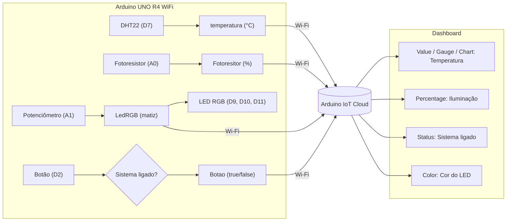

# Lâmpada Inteligente com Arduino UNO R4 WiFi + Arduino IoT Cloud

Projeto de IoT em que um **Arduino UNO R4 WiFi** lê sensores físicos (temperatura, luz, botão e potenciômetro), controla um **LED RGB** e envia tudo para um **dashboard no Arduino IoT Cloud**.


## Sumário
- [Como funciona](#como-funciona)
- [Dados do dashboard](#dados-do-dashboard)
- [Fluxo dos dados](#fluxo-dos-dados)
- [Componentes e pinagem](#componentes-e-pinagem)
- [Como rodar](#como-rodar)
- [Montando o dashboard](#montando-o-dashboard)
- [Configurações do código](#configurações-do-código)
- [Estrutura do repositório](#estrutura-do-repositório)

## Como funciona
- **Botão**: cada aperto liga ou desliga o sistema inteiro.
- **Potenciômetro**: escolhe a cor do LED RGB percorrendo o círculo de cores (vermelho → amarelo → verde → ciano → azul → magenta → vermelho).
- **Fotoresistor (LDR)**: mede a iluminação do ambiente em %.
- **DHT22**: mede a temperatura em °C a cada 2 segundos.
- Com o sistema **desligado**, o LED apaga e os sensores param de atualizar o painel.
- O código não usa `delay()` no `loop`: tudo é temporizado com `millis()` para não travar `ArduinoCloud.update()`.

## Dados do dashboard

O Thing no Arduino IoT Cloud tem **4 variáveis**, todas **READ** (a placa envia, o painel só mostra) e atualizadas **ON_CHANGE**, no máximo uma vez por segundo.

| Variável no Cloud | Tipo | O que mostra | Unidade / formato | Faixa | Precisão | Origem física | Pino | Widget sugerido |
|---|---|---|---|---|---|---|---|---|
| `temperatura` | `float` | Temperatura do ambiente | °C | −40 a 80 (limite do DHT22) | 0,1 °C | Sensor DHT22 | D7 | **Value**, **Gauge** ou **Chart** |
| `Fotoresitor` | `float` | Iluminação do ambiente | % (0 = escuro, 100 = muito claro) | 0 a 100 | 1 % | Fotoresistor (LDR) em divisor de tensão | A0 | **Percentage** ou **Value** |
| `Botao` | `bool` | Se o sistema está ligado | `true` = ligado, `false` = desligado | true / false | — | Botão de pressão (alterna a cada aperto) | D2 | **Status** |
| `LedRGB` | `CloudColor` | Cor que o LED RGB está mostrando | Matiz (0 a 360°), saturação e brilho (0 a 100) | Matiz em passos de 5° | 5° | Potenciômetro escolhe a cor; LED RGB exibe | A1 (pot.), D9/D10/D11 (LED) | **Color** |

> O nome `Fotoresitor` (sem o segundo "s") é o nome exato da variável criada no Thing. Se for renomear, mude no Cloud e no código ao mesmo tempo.

### Detalhes de cada variável

**`temperatura`**
- Lida com `temperatureSensor.readTemperature()` a cada 2 s (`DHT_READ_INTERVAL_MS`), porque o DHT22 não aceita leituras mais rápidas.
- Arredondada para 0,1 °C (`TEMPERATURE_STEP_CELSIUS`) para não enviar ruído.
- Se a leitura falhar (`NaN`), o painel mantém o último valor válido e o Monitor Serial mostra `[DHT22] Falha na leitura`.

**`Fotoresitor`**
- O UNO R4 lê o pino A0 com 14 bits (0 a 16383). O valor passa por um filtro de média móvel (`SMOOTHING_FACTOR = 0.2`) e é convertido para %:
  `luz % = leitura filtrada / 16383 × 100`
- Arredondado para 1 % (`LIGHT_STEP_PERCENT`).
- Se o valor aparecer invertido (sobe quando escurece), mude `INVERT_PHOTORESISTOR` para `true`.

**`Botao`**
- Não é o estado instantâneo do botão: é o **estado do sistema**. Cada aperto confirmado (debounce de 50 ms) alterna entre ligado e desligado.
- Começa como `true` (ligado) quando a placa liga.

**`LedRGB`**
- A posição do potenciômetro (A1) vira um ângulo de matiz: `matiz = posição / 16383 × 360°`, arredondado em passos de 5° (`HUE_STEP_DEGREES`) para a cor não "tremer".
- Enviado como `Color(matiz, 100, 100)`. Com o sistema desligado, é enviado `Color(matiz, 0, 0)`, e o widget mostra o LED apagado.

| Posição do potenciômetro | Matiz | Cor no LED e no widget |
|---|---|---|
| 0 % | 0° | Vermelho |
| ~17 % | 60° | Amarelo |
| ~33 % | 120° | Verde |
| 50 % | 180° | Ciano |
| ~67 % | 240° | Azul |
| ~83 % | 300° | Magenta |
| 100 % | 360° → 0° | Vermelho |

### Resumo do Thing

| Item | Valor |
|---|---|
| Placa | Arduino UNO R4 WiFi |
| Conexão | Wi-Fi (`WiFiConnectionHandler`) |
| Device ID (`DEVICE_LOGIN_NAME`) | `226b062f-7c61-4ae8-b25f-d509ebe86cc4` |
| Variáveis | 4 (todas READ, ON_CHANGE) |
| Frequência máxima de envio | 1 vez por segundo (`CLOUD_PUBLISH_INTERVAL_MS`) |
| Monitor Serial | 9600 baud, relatório a cada 2 s |

> O Device ID é só um identificador público. A **Secret Key** do dispositivo e a senha do Wi-Fi **não** estão neste repositório.

## Fluxo dos dados



## Componentes e pinagem

| Componente | Pino do UNO R4 | Observação |
|---|---|---|
| Botão | D2 e GND | Usa o pull-up interno, não precisa de resistor |
| DHT22 (dados) | D7 | VCC no 5 V, GND no GND; 10 kΩ entre dados e 5 V se não for módulo |
| Fotoresistor | A0 | 5 V → LDR → A0 → 10 kΩ → GND |
| Potenciômetro | A1 | Pino do meio no A1, pontas no 5 V e GND |
| LED RGB vermelho | D9 | Resistor de 220 Ω |
| LED RGB verde | D10 | Resistor de 220 Ω |
| LED RGB azul | D11 | Resistor de 220 Ω |
| LED RGB comum | GND (catodo) ou 5 V (anodo) | Se for anodo, mude `LED_IS_COMMON_ANODE` para `true` |

**Bibliotecas:** `ArduinoIoTCloud` (com dependências) e `DHT sensor library` da Adafruit, que pede também `Adafruit Unified Sensor`.

## Como rodar

### Pelo Arduino Cloud Editor
1. Crie o Thing com as 4 variáveis da tabela acima (mesmos nomes e tipos, permissão **Read Only**, atualização **On change**).
2. Associe o UNO R4 WiFi ao Thing e configure o Wi-Fi na aba **Secret**.
3. Cole o conteúdo de [`lampada_inteligente_r4/lampada_inteligente_r4.ino`](lampada_inteligente_r4/lampada_inteligente_r4.ino) no `.ino` gerado pelo Cloud.
4. Em *Libraries*, marque `DHT sensor library` e `Adafruit Unified Sensor`.
5. Envie para a placa.

### Pelo Arduino IDE no computador
1. Abra a pasta `lampada_inteligente_r4/`.
2. Copie `arduino_secrets.h.example` para `arduino_secrets.h` e preencha o Wi-Fi e a Secret Key do dispositivo.
3. Adicione `#include "arduino_secrets.h"` no topo do `.ino`, antes de `#include "thingProperties.h"`.
4. Instale as bibliotecas pelo Library Manager e envie para a placa.
5. Abra o Monitor Serial em **9600 baud** e confira a conexão com o Cloud.

## Montando o dashboard
1. No Arduino Cloud, abra **Dashboards → Create Dashboard** (ex.: "Lâmpada Inteligente").
2. Clique em **Add → Widgets** e ligue cada widget à variável com **Link Variable**:
   - **Value** (ou **Gauge**/**Chart**) → `temperatura`, título "Temperatura (°C)".
   - **Percentage** (ou **Value**) → `Fotoresitor`, título "Iluminação (%)".
   - **Status** → `Botao`, título "Sistema ligado".
   - **Color** → `LedRGB`, título "Cor do LED".
3. Como todas as variáveis são READ, os widgets só mostram valores; o controle é feito pelos componentes físicos.

## Configurações do código

Constantes no topo de [`lampada_inteligente_r4.ino`](lampada_inteligente_r4/lampada_inteligente_r4.ino):

| Constante | Padrão | Para que serve |
|---|---|---|
| `LED_IS_COMMON_ANODE` | `false` | `true` se o LED RGB for de anodo comum |
| `INVERT_PHOTORESISTOR` | `false` | `true` se a % de luz estiver ao contrário |
| `ANALOG_RESOLUTION_BITS` | `14` | Resolução do ADC do UNO R4 (0 a 16383) |
| `BUTTON_DEBOUNCE_MS` | `50` | Debounce do botão |
| `DHT_READ_INTERVAL_MS` | `2000` | Intervalo de leitura do DHT22 |
| `ANALOG_READ_INTERVAL_MS` | `50` | Intervalo de leitura do LDR e do potenciômetro |
| `CLOUD_PUBLISH_INTERVAL_MS` | `1000` | Intervalo máximo de envio ao painel |
| `SERIAL_REPORT_INTERVAL_MS` | `2000` | Intervalo do relatório no Monitor Serial |
| `SMOOTHING_FACTOR` | `0.2` | Força do filtro das leituras analógicas (0 a 1) |
| `HUE_STEP_DEGREES` | `5.0` | Passo da matiz da cor |
| `LIGHT_STEP_PERCENT` | `1.0` | Arredondamento da luz |
| `TEMPERATURE_STEP_CELSIUS` | `0.1` | Arredondamento da temperatura |

## Estrutura do repositório

```
.
├── README.md
├── .gitignore                         # ignora arduino_secrets.h
├── lampada_inteligente_r4/            # versão atual (UNO R4 WiFi)
│   ├── lampada_inteligente_r4.ino     # sketch principal
│   ├── thingProperties.h              # gerado pelo Arduino Cloud (não editar)
│   └── arduino_secrets.h.example      # modelo de segredos para o Arduino IDE
└── versao-anterior-esp32/             # primeira versão do projeto (ESP32), só como histórico
    └── lampada_inteligente/
        ├── lampada_inteligente.ino
        └── thingProperties.h
```

A pasta `versao-anterior-esp32/` guarda a primeira versão, feita para ESP32, que tinha mais variáveis (umidade, buzzer, comandos pelo painel). Ela não corresponde ao dashboard atual.
